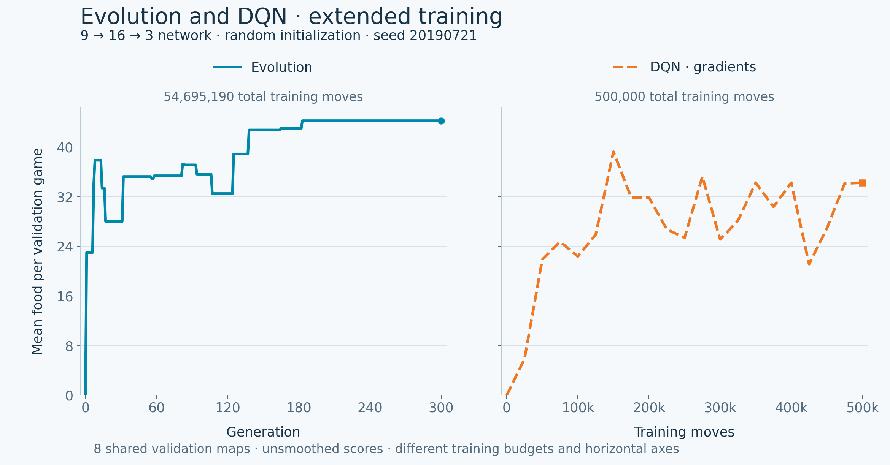

<div align="center">


**Evolution or gradients. Train real agents, compare their learning curves, and watch them play.**

[Try the demo](#try-the-demo) · [Training curves](#a-real-comparison) · [Hyperparameters](#hyperparameters) · [Command line](#command-line) · [Original Python](test.py)

</div>

## Try the demo

Open [`demo/index.html`](demo/index.html) in a modern browser, or run:

```sh
npm run preview
```

Then open **http://127.0.0.1:4174**. The server listens on your computer only and serves the demo assets. The demo needs no dependencies, accounts, GPU, or Pygame window.

1. Choose **Compare both**, **DQN · gradients**, or **Evolution**.
2. Leave **Training length** on **Per method**: evolution completes **300 generations**, while DQN gets its own **500,000-move budget**. Set the seed or adjust either length. **Random (from scratch)** is the default.
3. Open **Hyperparameters** to change mutation, learning rate, exploration, rewards, and more.
4. Start training. **Pause training**, **Resume training**, and **Stop** work independently of gameplay.
5. Select an **Evolution** or **DQN** checkpoint and **Watch best model**. Both models remain available in the gameplay selector.
6. Download the model or the raw curve data. Saved model JSON files can be imported again.

The page initially displays a clearly labeled **recorded comparison**. Pressing **Train both methods** replaces it with measurements from a new run. No training is simulated for display.

Training runs in a background worker, with a cooperative fallback when workers are unavailable. Closing or reloading the page ends the active session. Applied models are cached locally when storage is available. A downloaded model contains weights and training metadata, not optimizer or replay-buffer state: **Current model** starts a new training run from those weights.

## A real comparison



The default trains evolution for **300 complete generations**, totaling **54,695,190 moves and 86,400 games**. DQN receives **500,000 moves** independently. Both start from random weights with seed `20190721` and use the same **9 → 16 → 3** network size. The two plots have separate horizontal axes: generations for evolution, moves for DQN. Their vertical scale and eight validation maps are shared.

Why separate lengths? Evolution divides its total move budget across the whole population. With 96 candidates and three games each, one generation requires **288 games**. The previous 500,000-move benchmark completed only **14 generations**. Equal environment moves can compare sample efficiency, but that small budget is a poor default for exploring longer evolutionary training.

| Measurement | Evolution | DQN |
| --- | ---: | ---: |
| Completed generations | 300 | — |
| Training moves | 54,695,190 | 500,000 |
| Best validation food / game | 44.250 | 39.250 |
| Final validation food / game | 44.250 | 34.250 |
| Selected checkpoint: mean food on 20 separate test maps | 38.500 | 32.500 |

These are **different training budgets and one training seed**, not a ranking of algorithm efficiency. DQN learns but fluctuates; its best checkpoint occurs before its final one. Evolution's saved checkpoint was selected at generation **183**, but training still completed all **300** generations. The UI and model metadata distinguish the selected checkpoint from the total training run.

Validation runs with exploration off, never updates weights, and does not count toward training moves. The eight validation maps select saved checkpoints. The 20 additional test maps are evaluated only after selection and never choose a model.

The command-line run took about **71 seconds for evolution and 6 seconds for DQN** on the development machine. Runtime depends on hardware and settings. Evolution is validated after every generation in per-method mode; DQN uses the configured move interval.

The same full browser run finished in about **90 seconds**, with all 300 generations and 86,400 evolutionary games completed. [View the completed browser run](docs/assets/training-300-generations.jpg).

- [Full extended-run data, configuration, test scores, and both models](docs/examples/comparison-300-generations.json)
- [Vector plot](docs/assets/training-comparison-long.svg)
- [Previous equal-500,000-move benchmark](docs/examples/comparison-500k.json) and its [plot](docs/assets/training-comparison.png)
- [Earlier 100-generation random-start evolutionary model](docs/examples/random-model-100.json)

Reproduce the recorded run and update the demo's bundled comparison:

```sh
npm run compare
```

Choose **Same move budget** in the UI for the original sample-efficiency benchmark. In that mode evolution shares the budget across all candidates, stops at the exact move limit, and never promotes a budget-truncated candidate evaluation. The chart overlays both methods against the same move axis. A safety limit also stops evolution after 1,000 generations.

To regenerate the static figures, install Matplotlib in a Python environment and run:

```sh
python3 scripts/plot-training.py
```

## Hyperparameters

The page exposes these settings; the defaults below are used by the recorded comparison.

| Setting | Default | Effect |
| --- | --- | --- |
| Training length | Per method | Evolution completes its generation target; DQN has an independent move budget |
| DQN move budget | 500,000 | Limits DQN's environment steps |
| Random seed | 20190721 | Reproduces initialization and training randomness |
| Population | 96 | Candidates per evolutionary generation |
| Evolution generations | 300 | Complete selection and breeding rounds, with no shared DQN move cutoff |
| Mutation rate | 0.14 | Probability of perturbing each child weight |
| Mutation scale | 0.65 → 0.30 | Standard deviation of perturbations; changes after 60% of the generation target or matched-move budget |
| Elite / parent fraction | 0.06 / 0.20 | Retained candidates and breeding pool, with minimum counts for small populations |
| Random immigrants | 0.05 | Probability of replacing a child with fresh random weights |
| Learning rate | 0.001 | Adam's gradient update size |
| Discount γ | 0.95 | Importance of future rewards |
| Exploration ε | 1.00 → 0.05 | Chance of a random training action |
| Exploration decay | 150,000 moves | Linear schedule from initial to final ε |
| Batch size / replay capacity | 32 / 20,000 | Experiences per update and retained transitions |
| Warmup | 1,000 moves | Collects experiences before gradient updates |
| Learn / target sync interval | 4 / 1,000 moves | Update frequency and frozen-target refresh frequency |
| Food / death or timeout reward | +10 / −10 | DQN's main feedback |
| Distance reward / step reward | ±0.10 / −0.01 | Dense feedback for movement toward or away from food |
| Moves per game / without food | 1,200 / 180 | Shared training and validation episode limits |
| Validation interval | Every generation / 25,000 moves | Evolution in per-method mode / DQN and matched-move runs |

Start with **learning rate**, **exploration decay**, and **γ** for DQN; try **mutation scale**, **mutation rate**, and **population** for evolution. A larger value is not automatically better. Reward magnitudes change what DQN learns to optimize; the comparison chart always measures food.

The evolutionary objective is `120 × food + 0.4 × distanceReward + 0.025 × moves − 35 on collision`. Its distance score adds `1` for approaching food and subtracts `1.5` for moving away.

DQN is **Double DQN**, with uniform experience replay, a frozen target network, Huber loss, global gradient clipping at `5`, and Adam. Its target is `reward + γ × targetQ(nextState, argmax onlineQ(nextState))`, or just `reward` on a terminal transition. The hidden layer uses sigmoid activations; DQN's output layer is **linear** so it can represent negative and unbounded Q values. Evolution retains the original sigmoid outputs. Neither output should be interpreted as action probabilities.

## Gameplay replay


- **0.5× to 16× playback**, with 4× / 60 moves per second as the default.
- **Pause, replay, step, timeline seeking, next food**, and new maps.
- Nine input signals, three output values, and the chosen action.
- Correct **Q-value** labels and relative bars for DQN, including negative values.
- Separate entries for the original demo, trained Evolution, trained DQN, and imported models.

A game is simulated before playback. Elapsed time drives the animation, so speed changes cannot affect outcomes or training speed. Gameplay uses additional maps and allows up to 2,000 moves / 250 moves without food; its scores need not equal the shorter validation games.

## Command line

Train a DQN and save its best validation checkpoint:

```sh
npm run train -- --algorithm dqn --steps 500000 \
  --learning-rate 0.001 --gamma 0.95 --epsilon-decay 150000 \
  --output dqn-model.json
```

Train evolution for complete generations:

```sh
npm run train -- --algorithm evolution --budget-mode per-method --generations 300 \
  --population 96 --mutation-rate 0.14 --mutation-scale 0.65 \
  --output evolution-model.json
```

Run a matched-move benchmark explicitly:

```sh
npm run train -- --algorithm compare --budget-mode matched-moves \
  --steps 500000 --output matched-moves.json
```

Use a saved model as the starting weights:

```sh
npm run train -- --algorithm dqn --steps 500000 \
  --init current --model dqn-model.json --output continued-model.json
```

Without `--model`, **current** uses `demo/policy.js`. Evolution also supports an explicitly rule-based `--init heuristic`. DQN accepts random or current weights; loading sigmoid model weights into its linear head preserves initial action rankings.

Running `npm run train` without options retains the generation-based entry point: random initialization, 96 candidates, 100 generations, and output to **`demo/policy.js`**. Supply `--output` to keep a separate file. In per-method mode, `--steps` applies only to DQN. An explicitly supplied move budget without `--budget-mode` retains the older matched-move behavior.

Both entry points use the exact same engines as the browser. There is no frame-rate wait during training.

## Original project preserved

All seven original Python files remain unchanged. `test.py` used `game_old.py` with a **9 → 16 → 3** network and a 90 Hz display limit; the separate `game.py` prototype used 9 → 18 → 7 → 3 and a 15 Hz limit.

The bundled demonstration policy was previously evolved from a documented heuristic initialization: 64 candidates, 60 generations, seed `20190721`. It stays available as **Bundled demo model**. The original 2019 repository contained no saved trained weights.

The new simulator retains the training entry point's architecture and input ordering while correcting invalid initial body placement, food placement, full-board handling, and movement into a vacated tail cell. This is a corrected environment, not a reproduction of the original Pygame bugs. Both reactive agents can still trap themselves.

## Verification and layout

```sh
npm test
npm run check
npm run verify:network
```

The dependency-free tests cover game rules, deterministic training, replay timing, original NumPy inference fixtures, all **211 backpropagation derivatives** against numerical differences, terminal TD targets, Double DQN action selection, Adam, replay-buffer ownership, equal budgets, checkpoint validation, pause/resume, and self-contained worker execution. `verify:network` additionally needs Python with NumPy; set `SNAKE_PYTHON` to choose its executable.

```text
*.py                       Original Pygame / NumPy experiment
demo/engine.js             Headless game and network inference
demo/evolution.js          Genetic training and model validation
demo/dqn.js                Double DQN, replay buffer, backpropagation, Adam
demo/experiment.js         Training lengths, validation, checkpoint selection
demo/training-runner.js    Cooperative scheduling and pause/resume
demo/training-ui.js        Hyperparameters, worker control, learning curves
demo/comparison.js         Recorded comparison with both trained models
demo/app.js                Model selection, replay, and decision inspector
scripts/train.cjs          Shared command-line training
scripts/plot-training.py   Static PNG / SVG figures from real run data
tests/                     Game, network, playback, and training checks
```

English UI, readable text, cyan/orange visuals. Training and inference stay local.
