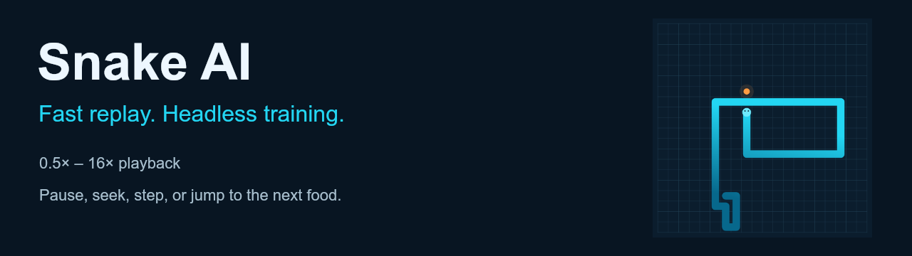
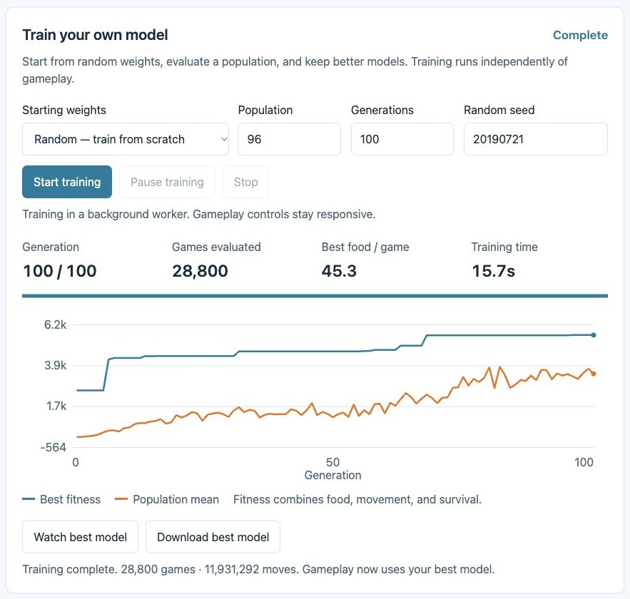
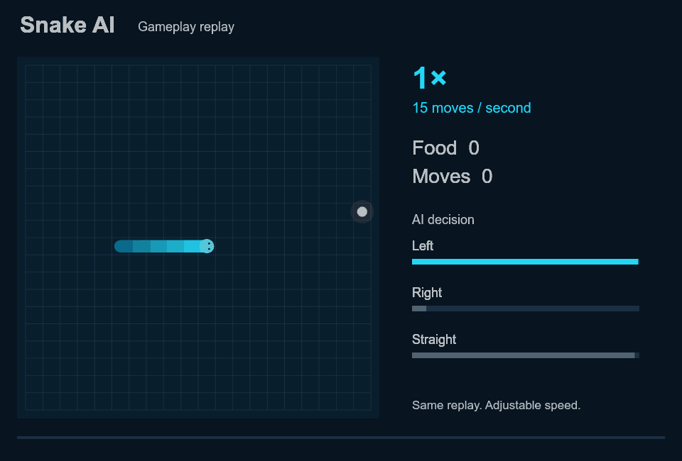

<div align="center">



**Train a real neural-network policy in your browser, then watch it play.**

[Browser training](#train-in-the-browser) · [Gameplay replay](#gameplay-replay) · [Command-line training](#command-line-training) · [Original Python](game_old.py)

</div>

## Train in the browser

Open **[`demo/index.html`](demo/index.html)** in a modern browser, or run:

```sh
npm run preview
```

Then open **http://127.0.0.1:4174**. The server listens only on your computer and serves only the demo assets.

The **Train your own model** panel starts actual genetic evolution. It does not replay a saved training curve or merely generate another game.

1. Leave **Starting weights** set to **Random (from scratch)** to initialize a new population. The default is 96 candidates, 100 generations, seed `20190721`.
2. Select **Start training**. Generation counts, evaluated games, simulated moves, elapsed time, and the fitness chart come from the running trainer.
3. **Pause training** freezes the session; **Resume training** continues it. **Stop** cancels further work and keeps the best completed checkpoint available on the page.
4. **Watch best model** loads the current checkpoint into gameplay while training can continue. Completion automatically switches gameplay to the trained model.
5. **Download best model** saves a JSON checkpoint. **Load a saved model** imports it. The gameplay model selector keeps the bundled demo separate from your trained or imported model.

Choose **Current model** only when you want to warm-start from the selected gameplay model. Random initialization is the default.



A verified browser run from random weights completed **100 generations, 28,800 games, and 11,931,292 simulated moves in 15.7 seconds** on the development machine. The best mean food score on the three training seeds went from **21.0 in generation 1 to 45.3 in generation 100**. Runtime varies by machine. Charts report training-seed performance; gameplay uses separate validation seeds.

The exported checkpoint from that run is available as [random-model-100.json](docs/examples/random-model-100.json). All 211 weights differ from the bundled demonstration model.

Training uses a dedicated browser worker. The worker code is built from the same local modules, without fetching scripts, so direct-file usage is supported. When workers are unavailable, a cooperative fallback yields between short batches to keep the page responsive. Closing or reloading the page ends an active training session; download a checkpoint before leaving. Applied trained models are also cached locally when browser storage is available.

## Gameplay replay



- **Default 4× playback:** 60 moves per second, compared with the original `game.py` rate of 15.
- **0.5× / 1× / 2× / 4× / 8× / 16×:** change speed without restarting a game.
- **Pause, replay, step, and seek:** inspect any moment.
- **Next food:** skip to the next food event, or the finish when none remain.
- **AI inspector:** inspect nine input signals, three output activations, and the selected action.
- **New run:** generate another game with the currently selected model.

A replay is computed before playback. Its clock advances by elapsed time, not by counting rendered frames. At high speed one rendered frame can advance several moves. Changing replay speed cannot change a game result or training speed.

Network output activations are independent sigmoid values, not probabilities. The highest value selects left, right, or straight.

## Command-line training

The browser and command line share the same `Evolution` implementation:

```sh
npm run train
```

This now defaults to random initialization, 96 candidates, and 100 generations. It writes `demo/policy.js`; reload the page to use it as the bundled model.

Parameters and a separate output path are available:

```sh
npm run train -- --population 64 --generations 150 --seed 42 --output my-model.json
```

Use `--init current` to warm-start from `demo/policy.js`, or `--init heuristic` for an explicitly rule-based starter. Neither is the default. Import a saved JSON output through the browser's model loader.

No Pygame window or frame-rate wait is involved. The original `test.py` instantiated and rendered each game serially; this trainer evaluates games directly in memory and only sends progress summaries to the UI.

## Bundled demo and original project

The initial bundled policy is an earlier model evolved from a documented heuristic initialization: 64 candidates, 60 generations, seed `20190721`. It remains available as **Bundled demo model** for comparison. No trained weights were included in the original 2019 repository.

All seven original Python files remain unchanged. `test.py` used `game_old.py` with a **9 → 16 → 3** network and a 90 Hz display limit; the separate `game.py` prototype used 9 → 18 → 7 → 3 and a 15 Hz limit.

The browser uses the training entry point's architecture and input ordering. Its simulator corrects invalid initial body placement, keeps food inside the board and off the snake, handles a full board, and permits moving into a vacated tail cell. It is a corrected environment, not a byte-for-byte reproduction of Pygame bugs. The reactive network can still trap itself; the replay shows actual outcomes, including collisions.

## Verify

```sh
npm test
npm run check
```

The dependency-free suite covers deterministic games, collisions, growth, food events, NumPy network-reference fixtures, replay timing, random and warm-start training, actual champion fitness, immutable checkpoints, pause/resume, cancellation, model validation, and the self-contained worker code.

To compare inference with the original `network.py`, using Python with NumPy installed:

```sh
npm run verify:network
```

Set `SNAKE_PYTHON` to choose a Python executable.

## Layout

```text
*.py                       Original Pygame / NumPy experiment
demo/engine.js             Headless game and neural-network inference
demo/evolution.js          Shared incremental genetic trainer
demo/training-runner.js    Cooperative scheduling and pause/resume
demo/training-ui.js        Worker control, live chart, checkpoints
demo/playback.js           Frame-rate-independent replay clock
demo/renderer.js           Shared board renderer
demo/policy.js             Bundled demonstration model
demo/app.js                Model selection, replay, and AI inspector
scripts/train.cjs          Command-line entry into the same trainer
tests/                     Engine, network, replay, and training checks
```

The interface uses English, readable text, and cyan/orange visuals. Training and inference remain local to the browser or command-line process.
